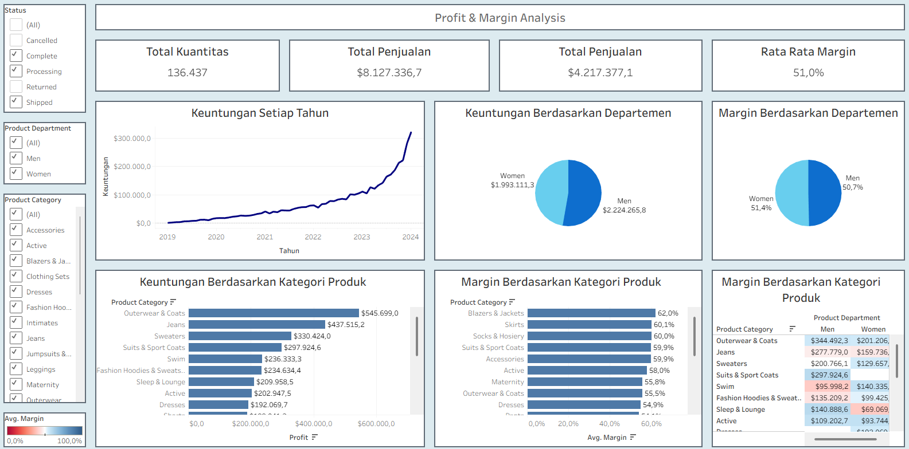

# Profit & Margin Analysis

Analisis keuntungan dan margin sebuah perusahaan e-commerce fashion berdasarkan **kategori produk** dan **departemen produk** (Men dan Women), menggunakan Python dan Tableau.



🔗 **Dashboard interaktif (Tableau):** [Lihat dashboard](https://public.tableau.com/app/profile/ahmad.malik.ibrahim6201/viz/DashboardProfitMarginAnalysisAhmadMalikIbrahim/Dashboard1?publish=yes)

---

## Latar Belakang

Perusahaan e-commerce fashion ini menjual produk untuk pelanggan pria dan wanita dalam puluhan kategori. Penjualan yang besar belum tentu menghasilkan keuntungan yang besar, karena setiap produk memiliki modal dan margin yang berbeda. Selain itu, sebagian pesanan dibatalkan atau dikembalikan sehingga tidak menjadi pendapatan. Tanpa mengetahui kategori dan departemen mana yang benar-benar paling menguntungkan, perusahaan berisiko menaruh stok dan promosi pada produk yang kurang tepat.

## Pertanyaan Analisis

1. Apakah pesanan yang dibatalkan atau dikembalikan dipengaruhi oleh kategori produk, departemen produk, atau harga barang?
2. Bagaimana tren keuntungan perusahaan, dan kategori produk mana yang memberi keuntungan terbesar dan margin tertinggi?
3. Departemen dan kategori produk mana yang menguntungkan sekaligus bermargin tinggi, dan mana yang perlu diperbaiki?

## Dataset

| Keterangan | Detail |
|---|---|
| Sumber | [Looker Ecommerce BigQuery Dataset (Kaggle)](https://www.kaggle.com/datasets/mustafakeser4/looker-ecommerce-bigquery-dataset/) |
| File | `order_items.csv` dan `inventory_items.csv` (digabung dengan left join) |
| Ukuran | 181.759 baris dan 22 kolom |
| Format | CSV |

## Tools

Python (pandas, numpy, matplotlib, seaborn, scipy, scikit-learn) dan Tableau.

## Tahapan Analisis

1. **Data Understanding:** memeriksa tipe data, statistik deskriptif, missing value, duplikat, inkonsistensi, outlier, dan distribusi data (uji D'Agostino-Pearson).
2. **Data Cleaning:** mengubah kolom ID menjadi `category` dan kolom tanggal menjadi `datetime`, merapikan penulisan `product_name` dan `product_brand`, mengisi missing value dengan modus, serta menghapus kolom `sold_at` yang kosong seluruhnya.
3. **Feature Engineering:** membuat kolom `profit` (harga jual dikurangi modal), `margin` (keuntungan dibagi harga jual), dan `terjual` (penanda transaksi yang benar-benar terjadi).
4. **EDA:** analisis univariat, bivariat (uji chi-square dan Mann-Whitney U), dan multivariat (heatmap keuntungan dan margin per kategori dan departemen).
5. **Visualisasi:** dashboard Tableau dengan filter status, departemen, dan kategori produk.

## Uji Statistik Pesanan Dibatalkan

| Uji | Variabel | p-value | Hasil |
|---|---|---|---|
| Chi-square | Departemen produk dengan pesanan batal/retur | 0,6240 | Tidak ada bukti hubungan signifikan |
| Chi-square | Kategori produk dengan pesanan batal/retur | 0,9916 | Tidak ada bukti hubungan signifikan |
| Mann-Whitney U | Harga jual dengan pesanan batal/retur | 0,87 | Tidak ada perbedaan signifikan |

Karena tidak ditemukan hubungan dengan produk maupun harga, dan penjualan yang dibatalkan atau dikembalikan tidak menjadi pendapatan, analisis keuntungan dan margin selanjutnya **tidak menyertakan pesanan berstatus Cancelled dan Returned**.

## Hasil Utama

| Ukuran | Nilai |
|---|---|
| Total kuantitas terjual | 136.437 |
| Total penjualan | $8.127.336,7 |
| Total keuntungan | $4.217.377,1 |
| Rata-rata margin | 51,0% |
| Keuntungan Men / Women | $2.224.265,8 / $1.993.111,3 |
| Rata-rata margin Men / Women | 50,7% / 51,4% |

## Insight

Keuntungan perusahaan **naik setiap tahun**, yang menunjukkan bisnis terus bertumbuh. Dari sisi kategori, **Outerwear & Coats** memberi keuntungan terbesar ($545,7 ribu) dengan margin di atas rata-rata, sedangkan **Blazers & Jackets** memiliki margin tertinggi (62%) tetapi keuntungannya lebih kecil. Kategori **Jeans** menghasilkan keuntungan besar namun marginnya di bawah 50%, artinya keuntungannya datang dari banyaknya barang terjual, bukan dari untung per barang. Departemen **Men** menghasilkan keuntungan lebih besar, sementara margin **Women** hanya sedikit lebih tinggi (selisih sekitar 0,7 poin). Perbedaan yang lebih mencolok justru terlihat pada gabungan kategori dan departemen: **Swim** jauh lebih menguntungkan untuk wanita (margin 57,9% dibanding 40,0%), sedangkan **Sleep & Lounge** lebih baik untuk pria (60,1% dibanding 39,9%).

## Recommendation

Perusahaan disarankan menjaga ketersediaan **Outerwear & Coats** dan **Suits & Sport Coats** sebagai andalan keuntungan. **Blazers & Jackets** dapat ditawarkan kepada pembeli kategori yang paling banyak terjual, yaitu **Intimates**, agar potensi margin tingginya termanfaatkan. Untuk **Jeans**, dapat dipertimbangkan evaluasi harga jual atau biaya modal agar margin ikut membaik. Promosi dan stok juga disarankan disusun berdasarkan **gabungan kategori dan departemen**, misalnya memprioritaskan Swim untuk wanita dan Sleep & Lounge untuk pria, sementara kategori seperti **Clothing Sets** dan **Leggings** dapat dipertimbangkan untuk dievaluasi. Ke depan, pencatatan alasan pembatalan dan pengembalian pesanan disarankan agar penyebabnya dapat dianalisis lebih lanjut.

## Struktur Repository

```
Profit-And-Margin-Analysis/
├── Profit___Margin_Analysis_Ahmad_Malik_Ibrahim.ipynb          # Notebook analisis
├── Presentasi_Profit___Margin_Analysis_Ahmad_Malik_Ibrahim.pptx # Presentasi
├── Dashboard_Profit___Margin_Analysis.png                      # Tampilan dashboard
└── README.md
```

## Kontak

**Ahmad Malik Ibrahim**
📧 capt.malikibrahim@gmail.com
💼 [LinkedIn](https://www.linkedin.com/in/ahmad-malik-ibrahim/)
🐙 [GitHub](https://github.com/ahmad2129)
